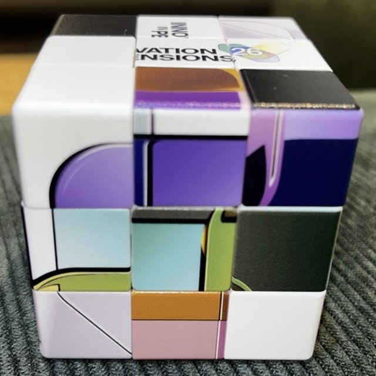
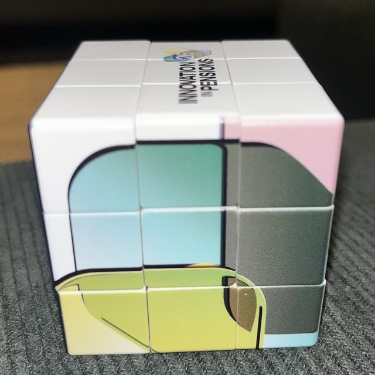
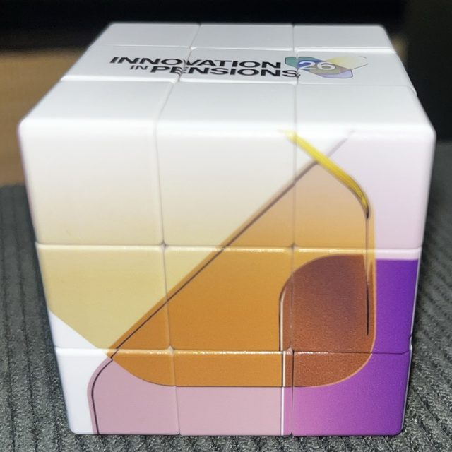
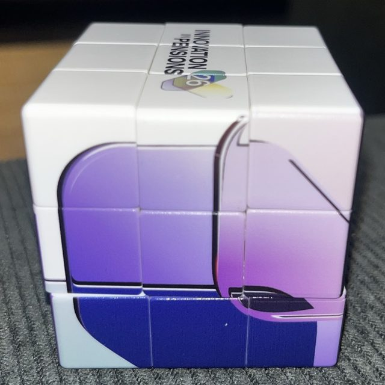
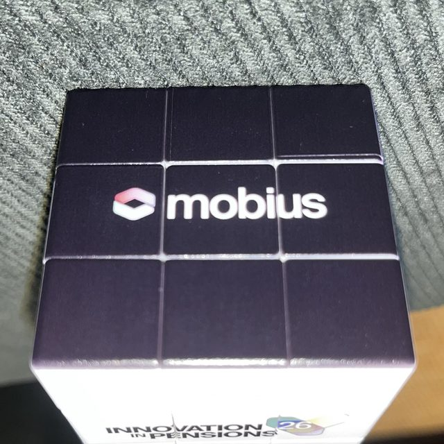
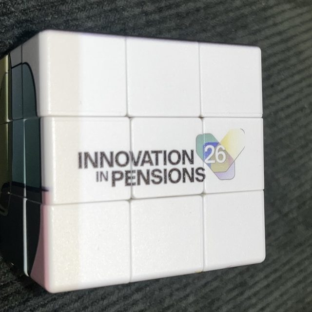
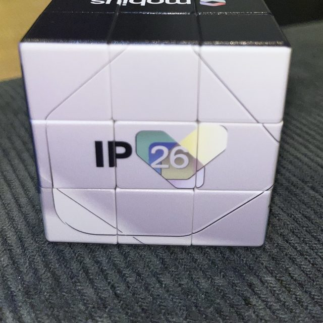
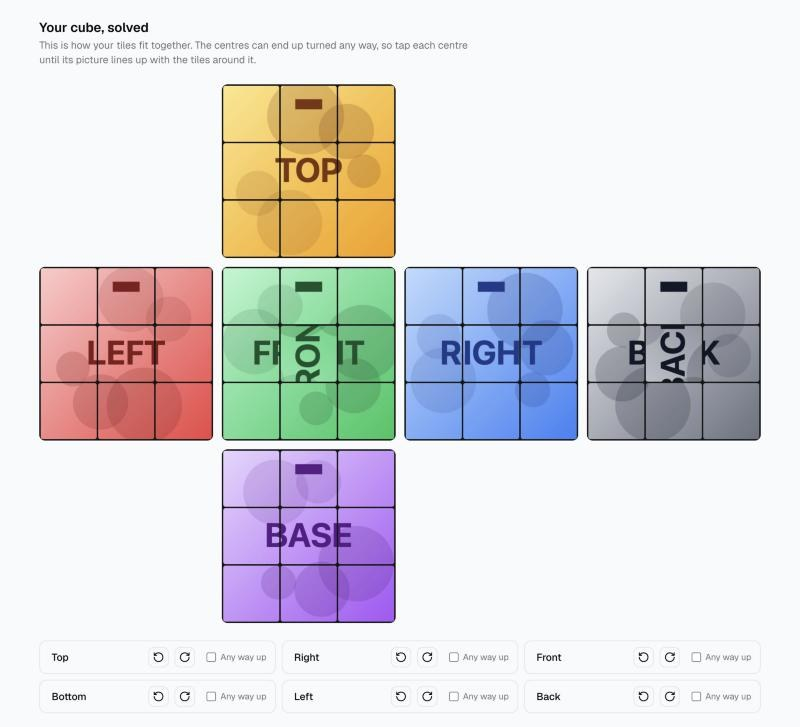

# Picture cube solver

[](https://github.com/patrickridge/picture-cube/actions/workflows/ci.yml)

Photograph a Rubik's cube that has pictures printed on it instead of colours, and get the moves to solve it, with every centre picture the right way up.

**The cube that inspired the idea**, scrambled and then solved:

<table>
  <tr>
    <td rowspan="2"><br><sub>Scrambled</sub></td>
    <td><br><sub>Front</sub></td>
    <td><br><sub>Right</sub></td>
    <td><br><sub>Back</sub></td>
  </tr>
  <tr>
    <td><br><sub>Left</sub></td>
    <td><br><sub>Top</sub></td>
    <td><br><sub>Bottom</sub></td>
  </tr>
</table>

## Why

I couldn't solve the cube above, and ordinary solvers don't help with it, for two reasons:

1. **The tiles don't have colours.** A tile is a fragment of a picture, and many fragments look alike (pale backgrounds, plain areas). Working out which side each tile belongs on is the hard part.
2. **Centres can be turned the wrong way.** On a colour cube a centre looks the same whichever way it faces. On a picture cube every piece can be in place while a centre is rotated, which spoils the picture. Solving it needs moves that turn the centres too.

## How it works

**Photos to tiles.** You take six photos in a set order (front, right, back, left, top, bottom) and line a square up with each face. The app cuts each face into nine tiles and records each tile's colour mix as a 64-bin histogram.

**Sorting tiles** (`lib/autosort.ts`). Each centre stays put, so it identifies its side. Tiles are handed out nine to a side by closest colour match to that side's tiles so far, and the hand-out is repeated a few times. You correct any it gets wrong by tapping.

**Checking it's a real cube** (`lib/pieces.ts`). Most misreads produce a cube that can't exist, and the app says why: a side with 10 tiles, a corner with two tiles from opposite sides, a piece that appears twice, or a corner that would need twisting in place. If changing one tile (or swapping two) would make it valid, it offers that change, which is almost always the right one.



**Previewing the solved cube** (`lib/cube.ts`). The cube is modelled as 54 stickers, each with a position, a facing and an "up" direction, turned with 3D rotations. That tracks which way every tile photo ends up facing, so the app can draw your cube solved from your own photos. You turn each centre in the preview until its picture lines up.

**Finding the moves** (`lib/solve.ts`). Kociemba's two-phase algorithm ([cubejs](https://github.com/ldez/cubejs)) solves the pieces in about 20 moves. Each quarter turn of a face also turns its centre, so a solution leaves each centre turned by however many quarter turns its face received (mod 4). Whatever is still wrong is fixed with a sequence from `lib/centre-fixes.json`, which turns centres and moves no pieces. The app then tries solutions that start with a few random moves, since one may turn the centres right by itself and save the extra moves.

The centre-fix table covers all 2,048 patterns a real cube can need (the turns always add up to an even number). It was built by `scripts/build-centre-fixes.mjs`: scramble a solved cube with a few random moves, solve it, and record which centre pattern scramble + solution produces. Each sequence found also covers 47 more patterns by turning or mirroring the whole cube. `lib/fixes.test.ts` checks every entry moves no pieces and turns the centres as labelled.

**Following along.** Moves come in groups of four, described as you see them ("Right side: front goes up"), with the front and top drawn from your photos after each group. A wrong turn shows up at the next check instead of at the end.

Everything runs in the browser, with the solver in Web Workers. Photos are never uploaded.

## Running it locally

Needs Node 24.

```bash
npm install
npm run dev
```

Then open http://localhost:3000, and choose "Try an example cube" if you don't have a picture cube to hand.

## Checks

```bash
npm test
npm run lint
npm run typecheck
npm run build
```

GitHub Actions runs all four on every push. The tests include real readings from photos of a scrambled cube, with the misread tile the checks caught.

## Code layout

```
lib/cube.ts              Sticker model: moves, which way each tile faces, centre turns
lib/pieces.ts            Is this a real cube? Problems and one-tile fixes
lib/autosort.ts          First guess at each tile's side from its colours
lib/solve.ts             Moves that solve the pieces and turn the centres right
lib/centre-fixes.json    Centre-only sequences for every pattern (generated)
lib/tiles.ts             Cutting a photo into tiles; colour histograms
lib/demo.ts              The example cube
components/              The four steps: photos, sorting, centres, moves
scripts/                 Builds the centre-fix table
```

Built with Next.js, TypeScript, Tailwind CSS and shadcn/ui.

## Limitations

- Photos need to be fairly straight on. The square crop doesn't correct for perspective.
- Sorting by colour struggles when two sides share a palette. The checks catch most mistakes, but some tiles may need tapping by hand.
- Solutions are around 20–40 moves depending on how many centres need turning, not the shortest possible.

## Licence

MIT. See [LICENSE](LICENSE).
